<!--
  ╭──────────────────────────────────────────────────────────────────────────╮
  │  GitHub profile README for Muhammad Haris (github.com/Muhammadgi)        │
  │  DevOps & Cloud Engineer · Linux Administrator · AI/ML Infrastructure    │
  │                                                                          │
  │  The animated SVGs in ./assets are generated from tools/config.js:       │
  │    powershell -ExecutionPolicy Bypass -File tools\build.ps1              │
  │  Step-by-step guide: SETUP.md                                            │
  ╰──────────────────────────────────────────────────────────────────────────╯
-->

<p align="center">
  
</p>

<p align="center">
  <a href="https://www.linkedin.com/in/muhammad-haris-323268236/"></a>
  <a href="https://x.com/HARISKHANHK9"></a>
  <a href="https://www.instagram.com/khanhkharis1/"></a>
  <a href="mailto:khanhkharis1@gmail.com"></a>
  <!-- ✏️ Portfolio: codebyharris.com no longer resolves. Put the live URL here, then remove the comment markers.
  <a href="https://YOUR-PORTFOLIO-URL"></a>
  -->
  
</p>

<p align="center">
  
</p>

## 🐧 About me

I'm a **DevOps & Cloud Engineer** and **Linux administrator** with deep expertise in **multi-cloud architecture**, **AI/ML infrastructure** and **Linux systems**. I design and operate highly available, observable and secure platforms, with automation at the core.

```yaml
apiVersion: people/v1
kind: Engineer
metadata:
  name: muhammad-haris
  labels:
    role: [devops-engineer, cloud-engineer, linux-administrator]
    focus: ai-ml-infrastructure
spec:
  replicas: 1                      # one of a kind
  mission: Scalable, secure, automation-first cloud platforms for AI-driven systems
  workingOn:
    - Production-grade LLM & RAG platforms
    - Model Context Protocol (MCP) server development
    - Kubernetes across AWS, Azure & GCP (EKS · AKS · GKE)
    - Infrastructure as Code with Terraform
    - Secure Linux systems & cloud networking
  livenessProbe:
    exec:
      command: ["coffee", "--strong"]
status:
  phase: Running
  currentlyLearning: [Advanced LLMOps, inference optimization, Platform Engineering & IDPs]
  openTo: [DevOps / Platform / Cloud roles, AI & LLM infrastructure consulting, open-source collaboration]
  funFact: "There's no place like 127.0.0.1"
```

## 🧰 Tech stack

<table>
  <tr>
    <td><b>🐧 Linux &amp; shell</b></td>
    <td>
      <br/>
      
      
      
      
      
    </td>
  </tr>
  <tr>
    <td><b>☁️ Cloud</b></td>
    <td>
      <br/>
      
      
    </td>
  </tr>
  <tr>
    <td><b>📦 Containers &amp; orchestration</b></td>
    <td>
      <br/>
      
      
      
      
    </td>
  </tr>
  <tr>
    <td><b>🏗️ Infrastructure as code</b></td>
    <td>
      <br/>
      
      
      
    </td>
  </tr>
  <tr>
    <td><b>🔁 CI/CD &amp; automation</b></td>
    <td>
      <br/>
      
      
    </td>
  </tr>
  <tr>
    <td><b>🤖 AI / LLM infrastructure</b></td>
    <td>
      
      
      
      
      
      <br/>
      
      
      
      
    </td>
  </tr>
  <tr>
    <td><b>📈 Observability &amp; security</b></td>
    <td>
      <br/>
      
      
      
      
      
    </td>
  </tr>
  <tr>
    <td><b>💻 Languages</b></td>
    <td></td>
  </tr>
</table>

## 🚀 Featured projects

<table>
  <tr>
    <td width="50%" valign="top">
      <h3><a href="https://github.com/Muhammadgi/aws-vpc-terraform">☁️ aws-vpc-terraform</a></h3>
      <p>Terraform project that deploys AWS VPC networking: public and private subnets, an internet gateway and route tables.</p>
      
      
      
    </td>
    <td width="50%" valign="top">
      <h3><a href="https://github.com/Muhammadgi/terraform-aws-ec2">🖥️ terraform-aws-ec2</a></h3>
      <p>Provisions an AWS EC2 web server with Terraform: VPC, security group, key pair and EBS storage, fully automated as code.</p>
      
      
      
    </td>
  </tr>
  <tr>
    <td width="50%" valign="top">
      <h3><a href="https://github.com/Muhammadgi/VPS-Daily-Health-Report">📈 VPS-Daily-Health-Report</a></h3>
      <p>Python monitoring tool that collects daily Linux VPS metrics and emails an HTML health report with embedded charts.</p>
      
      
      
    </td>
    <td width="50%" valign="top">
      <h3><a href="https://github.com/Muhammadgi/linux-package-service-automation">🐚 linux-package-service-automation</a></h3>
      <p>Interactive Bash script that automates package installation, system updates and service status checks.</p>
      
      
      
    </td>
  </tr>
</table>

### 📚 Guides & cheat sheets

| Repository | What's inside |
| --- | --- |
| [n8n-installation](https://github.com/Muhammadgi/n8n-installation) | Install n8n with a single command |
| [n8n-login-unable-to-sign-in](https://github.com/Muhammadgi/n8n-login-unable-to-sign-in) | Fix the n8n "Problem logging in" error without losing workflows |
| [WordPress-Installation-On-Ubuntu](https://github.com/Muhammadgi/WordPress-Installation-On-Ubuntu) | WordPress on Ubuntu with Apache, PHP and Let's Encrypt SSL |
| [Shell-Scripting](https://github.com/Muhammadgi/Shell-Scripting) | Check and install Linux packages with apt or yum |
| [Linux-Commands-Sheet-Devops-Sysadmin](https://github.com/Muhammadgi/Linux-Commands-Sheet-Devops-Sysadmin) | Linux command sheet for DevOps engineers and sysadmins |
| [Git-And-Github-Cheatsheet](https://github.com/Muhammadgi/Git-And-Github-Cheatsheet) | A complete guide to Git and GitHub |

## 🎓 Certifications

<p>
  <a href="https://www.coursera.org/account/accomplishments/records/YY50UWZYK0KK"></a>
  <a href="https://www.coursera.org/account/accomplishments/verify/1F5HKOY8KG56"></a>
  <a href="https://www.coursera.org/account/accomplishments/records/2BID8R234UJK"></a>
  
</p>

## 📊 GitHub stats

<p align="center">
  
  
</p>

<p align="center">
  
</p>

<!-- The snake is generated daily by .github/workflows/snake.yml into the "output" branch. -->
<p align="center">
  <picture>
    <source media="(prefers-color-scheme: dark)" srcset="https://raw.githubusercontent.com/Muhammadgi/Muhammadgi/output/github-snake-dark.svg" />
    <source media="(prefers-color-scheme: light)" srcset="https://raw.githubusercontent.com/Muhammadgi/Muhammadgi/output/github-snake.svg" />
    
  </picture>
</p>

## 📬 Let's build something great

💡 **Open to:** DevOps, Platform and Cloud roles · AI & LLM infrastructure consulting · open-source collaboration

📧 [khanhkharis1@gmail.com](mailto:khanhkharis1@gmail.com) · 🔗 [LinkedIn](https://www.linkedin.com/in/muhammad-haris-323268236/)

> If you value automation, reliability and scalable systems, let's connect.

<p align="center">
  
</p>
